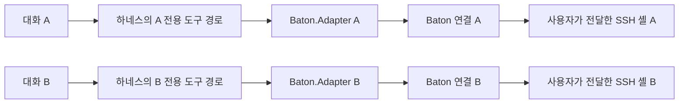

# 대화별 SSH 셸 격리 설계안

> **C# MVP 과거 기록:** 현재 구현은 Rust입니다. 이 문서의 C# 명령·경로·계약은 `csharp-mvp-final` 태그 기준이며 현재 실행 안내로 사용하지 않습니다. [보존·복구 안내](legacy-csharp.md)와 [Rust 개인 사용 안내](rust-personal-use.md)를 참고하세요.

작성일: 2026-09-16

상태: **설계만 작성. 구현·하네스 설정 변경·추가 실행 검증은 보류.** 사용자가 현재 MVP를 1차 테스트한 뒤 별도로 착수를 결정한다. 기존 implementation-plan.md의 완료 표시는 기존 MVP에만 적용한다.

## 1. 목표와 경계

대화 A의 Baton 도구 호출이 대화 B의 SSH 셸이나 공개 출력에 접근하지 못하게 한다. 사용자 직접 SSH 인증과 명시적 전달, 전달 후 사용자 입력 차단, 연결 단절 시 셸 종료는 기존 계약을 유지한다.

가장 큰 제약은 Baton이 대화를 직접 알지 못한다는 점이다. 하네스가 여러 대화의 호출을 같은 MCP 연결로 보내면 Baton만으로 발신 대화를 구분할 수 없다. 대화 이름, 모델이 제출한 conversation_id, 프로젝트 폴더, 별도 창은 그 자체로 격리 근거가 아니다.

이 설계의 범위는 신뢰하는 하네스 안에서의 Baton 도구 접근 격리다. 같은 Windows 사용자 권한으로 파일/프로세스를 직접 조작하는 다른 도구까지 차단하는 OS 보안 격리를 제공하지 않는다. 같은 원격 계정으로 만든 별도 셸은 원격 파일과 권한을 공유하므로 원격 계정 격리도 아니다.

## 2. 선택안: 대화마다 전용 어댑터

하네스가 대화별로 어댑터를 실행하고 해당 대화에 그 연결의 도구만 제공한다. 두 어댑터의 실행 파일은 같아도 프로세스와 stdio/IPC 연결은 별도다. Baton은 기존 연결 ID를 소유권 기준으로 사용한다.

| 대안 | 판단 |
|---|---|
| 대화별 전용 어댑터 | 채택. 기존 연결당 셸 하나 구조와 단절 정리를 재사용한다. |
| 공유 어댑터에서 대화 ID로 분기 | 보류. 하네스가 인증된 발신 문맥을 매 호출에 제공해야 하며 IPC/소유권/수명 관리가 복잡해진다. |
| 여러 MCP 항목을 등록하고 모델에게 자기 것만 사용하도록 지시 | 격리 방식으로 채택하지 않는다. 다른 항목을 호출할 권한이 남아 있다. |

## 3. 하네스별 적용 조건

우선 실제 하네스가 이미 대화별 stdio 프로세스를 생성하는지 확인한다. 독립 생성과 호출 제한이 검증되면 Baton의 핵심 소유권 코드는 변경할 필요가 없을 수 있다.

| 하네스의 실제 동작 | 적용 방식 |
|---|---|
| 대화별 연결 및 도구 접근 범위 제공 | 해당 기능을 사용하고 종료·재개·분기 동작까지 검증한다. |
| 대화별 연결 제어는 없지만 독립 실행 인스턴스 지원 | 실행 인스턴스당 대화 하나와 전용 MCP 연결로 운용한다. 새 창이 아니라 실제 독립 실행/연결인지 확인한다. |
| 연결 공유만 지원 | 대화별 격리 미지원으로 명시한다. 하네스 전용 연동이 별도 작업으로 승인되기 전에는 격리를 주장하지 않는다. |

Codex와 Claude Desktop의 지원 여부는 각각 미확정이다. 프로젝트별 MCP 설정 지원은 대화별 연결 격리의 증거로 사용하지 않는다. 별도 채팅 UI나 자체 AI 실행기는 이 변경 범위에 포함하지 않는다.

## 4. 사용자 흐름

1. 하네스에서 대화를 시작하고 Baton 도구를 활성화한다. 하네스가 전용 어댑터를 시작한다.
2. 해당 대화의 status 결과에 있는 연결 ID를 Baton의 연결 목록과 대조한다. 짧은 표시 ID가 겹치면 전체 ID로 확인할 수 있어야 한다.
3. 사용자가 Baton에서 새 SSH 셸을 연결·인증하고 준비한다.
4. 그 대화의 전용 연결을 선택해 셸을 전달한다. 연결 ID 대조는 사용자의 오배정 방지용이며, 하네스의 도구 접근 제한을 대신하지 않는다.
5. 해당 대화는 배정된 셸만 조작한다. 사용자에게는 대상과 소유 연결을 계속 표시한다.

연동이 신뢰할 수 있는 대화 표시 정보를 제공한다면 목록에 제목 또는 별칭을 추가할 수 있다. 표시 정보는 길이를 제한하고 메모리에만 보관한다. 기존 --label만으로 대화 신원이 인증되었다고 표시하지 않는다.

## 5. 수명 계약

| 사건 | 동작 |
|---|---|
| 대화의 실행 환경 시작 | 새 전용 어댑터 연결 생성, 미배정 상태로 시작 |
| 화면/탭 전환, 모델 턴 완료, 출력 대기 취소 | 연결을 종료할 사건으로 간주하지 않음 |
| 하네스가 대화 실행 환경을 명시적으로 종료 | 전용 어댑터 종료 → 소유 SSH 셸 종료 |
| 어댑터 EOF/실패/재시작 또는 앱 종료 | 해당 기존 연결의 셸 종료, 다른 대화의 셸에 영향 없음(앱 종료는 전체 종료) |
| 동일 대화를 살아 있는 실행 환경으로 다시 표시 | 기존 연결이 실제로 유지된 경우에만 기존 배정 유지 |
| 연결이 끊긴 대화 재개 | 새 연결과 새 사용자 인증·전달 필요. 대화 ID로 이전 셸을 되찾지 않음 |
| 대화 분기 또는 독립 하위 에이전트 | 기존 셸 권한을 자동 상속하지 않음. Baton이 필요하면 새 연결과 사용자 전달 필요 |
| 재개·분기 과정에서 하네스가 기존 연결을 다른 대화에 재사용 | 격리 지원 조건 위반. 해당 통합 방식은 사용하지 않음 |

대화 창을 닫는 행위와 실행 환경 종료의 관계는 하네스별로 검증해 문서화한다. 읽기 timeout으로 셸을 닫거나 임의의 유휴 만료를 추가하지 않는다. 현재 전체 한도인 MCP 연결 32개, 동시 SSH 세션 16개를 유지한다.

## 6. 예상 변경 범위

- **Baton.Core:** 연결당 셸 하나, 서버에서 정한 owner, 전달 경계와 종료 처리는 유지한다. 모델 인자로 소유 대화를 선택하는 API를 추가하지 않는다.
- **Baton.Adapter:** 네 MCP 도구를 유지한다. 필요할 경우 신뢰하는 하네스 실행 경로에서 제공한 표시 문맥만 초기 연결에 고정한다. 도구 호출로 문맥을 바꾸는 기능은 두지 않는다.
- **Baton.App:** 사용자 테스트 결과에 따라 연결 ID 복사/전체 보기와 소유 연결 표시를 보강한다. 대화 정보가 없으면 기존 연결 ID로 선택한다.
- **하네스 연동:** 대화별 프로세스 생성, 도구 노출 제한, 명시적 종료와 분기 처리를 담당한다. 실제 지원 기능 확인 후 설정만으로 충분한지, 별도 연동이 필요한지 결정한다.

기존 IPC 사용자 인증 비밀을 대화 ID로 대체하지 않는다. 대화 ID를 추가하더라도 인증 비밀이나 접근 권한으로 취급하지 않는다. SSH 대상·계정·암호·인증 준비를 모델에게 맡기지 않는다. 기존 sudo 사전 승인 지침과 입출력 비저장 정책은 유지한다.

## 7. 구현 후 인수 기준

아래는 향후 검증 계획이며 현재 통과한 결과가 아니다.

- 같은 하네스의 대화 A/B에서 status를 호출하면 서로 다른 연결 ID가 나온다.
- A의 도구 목록과 호출 경로에서 B의 어댑터를 선택할 수 없다. 다른 MCP 서버 이름을 알고 있어도 접근하지 못한다.
- A가 B의 session_id를 넣어 read/send를 호출하면 거부되고 B의 출력/입력이 변하지 않는다.
- 각 셸의 서로 다른 시험 출력이 상대 대화 결과에 나타나지 않는다.
- A의 종료·강제 종료·재개가 B에 영향을 주지 않는다. 끊어진 연결의 입력을 새 연결에 재전송하지 않는다.
- 분기/하위 에이전트에 기존 연결이 자동 상속되지 않는다. 하네스가 이를 보장할 수 없다면 제한을 명시한다.
- 사용자 입력 차단, 전달 전 출력 비공개, 중복·지연 입력, 버퍼 상한 등 기존 검증을 유지한다.
- Codex/Claude Desktop을 각각 실제로 확인한 범위만 지원 표에 기록한다. 합성 어댑터 시험으로 실제 하네스 검증을 대신하지 않는다.

## 8. 다음 결정 시점

사용자의 현재 MVP 1차 테스트가 먼저다. 이후 착수 지시가 있으면 사용할 하네스와 버전을 기준으로 대화별 연결 수명을 검증한다. 그 결과로 설정 수준 적용 또는 별도 연동 구현 중 하나를 확정한다. 이 문서 작성은 구현 착수 승인으로 간주하지 않는다.

참고: [MCP 호스트·연결 구조](https://modelcontextprotocol.io/specification/2025-06-18/architecture), [Codex MCP 설정](https://learn.chatgpt.com/docs/extend/mcp?surface=cli), [기존 Baton 설계](design.md).
