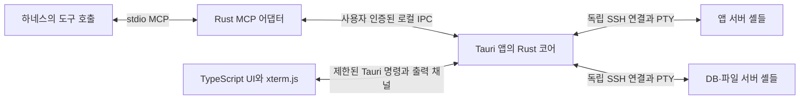

# Baton Rust 전환 설계 초안

작성일: 2026-09-20

상태: 2026-09-20 사용자 승인. HTML 검토본에 대한 “네 이렇게 갑시다”를 구조·검증 설계 승인으로 기록한다. 제품 구현·의존성 설치·하네스 설정 변경은 시작하지 않았다. 아래의 ‘설계 제안’은 승인된 초기 정책이며, 기술 검증 결과 변경이 필요하면 근거와 함께 갱신한다. 다음 산출물은 [단계 0 실행 계획](../plans/2026-09-20-rust-phase-0.md)이다.

2026-09-21 진행 기록: 위 상태와 라이브러리 후보 설명은 최초 승인 당시의 기록이다. 단계 0 자동 시험 73개를 수행했으며 실제 관측과 미확인은 [기술 검증 보고서](../../testing/rust-phase-0-report.md)에 남겼다. 사용자와 논의한 대로, 남은 물리 UI·WebView 하위 프로세스 종료 검증은 단계 2 완료 조건으로 옮기고 SDK 독립 코어 작업의 선행 차단에서는 분리한다. 전체 앱 수명은 단계 4, 배포본 인수는 단계 5에서도 검증한다. 이는 미확인의 통과 처리가 아니다. 현재 산출물은 [단계 1 상세 계획](../plans/2026-09-21-rust-phase-1-core.md)이며 구현 전 검토 대상이다.

## 1. 목적과 합의

Baton은 사용자가 직접 연결·인증한 원격 SSH 셸을 에이전트에 전달하고 필요할 때 회수하는 데스크톱 앱이다. 앱 서버와 DB·파일 서버를 한 대화에서 다루고, 같은 서버에도 실행·로그·상태 확인용 셸을 여러 개 둘 수 있어야 한다.

Rust 학습이 중요한 프로젝트 목적이다. C# 성능 한계가 확인되어서가 아니라, 재작성·재검증 비용을 고려하고도 Rust 중심 전환을 선택했다. SSH·동시성·소유권·MCP를 작은 단위로 이해하고 검증하는 흐름으로 진행한다.

| 이슈 | 합의한 방향 |
|---|---|
| [#1](https://github.com/bnbnac/baton/issues/1) | 같은 셸의 사용자 회수·재전달. 동시 입력 금지. 자동 Ctrl+C 및 실패 입력 자동 재실행 없음 |
| [#2](https://github.com/bnbnac/baton/issues/2) | 사용자 화면·스크롤백 유지. 비공개 구간의 저장 기록을 MCP에 재공개하지 않음 |
| [#3](https://github.com/bnbnac/baton/issues/3) | Rust 코어 + Tauri·TypeScript UI + xterm.js. Windows/macOS/Linux 지원 목표 |
| [#4](https://github.com/bnbnac/baton/issues/4) | 한 연결에 복수 셸. 다른 연결과 셸·입출력·수명 격리. 대화별 격리는 하네스 검증 조건부 |
| [#5](https://github.com/bnbnac/baton/issues/5) | 사용자·에이전트 소유 모두 자동 크기 변경. 초기 고정 모드 제외 |
| [#6](https://github.com/bnbnac/baton/issues/6) | 승인 전에 최종 sudo -n 명령을 제시하도록 지침 수정 |
| [#7](https://github.com/bnbnac/baton/issues/7) | 실행 승인과 인증을 분리. 인증 필요 시 #1의 사용자 개입 흐름 사용 |
| [#8](https://github.com/bnbnac/baton/issues/8) | 일반 SSH 클라이언트와 종료 동작 비교. 동등하면 추가 원격 kill 기능 없이 문서화 |
| [#9](https://github.com/bnbnac/baton/issues/9) | 앱 종료 후 MCP 어댑터 유지·오프라인 안내. 앱 재실행 시 새 연결·새 전달 필요 |

추가 합의: Windows부터 검증·배포하고 macOS·Linux를 순차 추가한다. 테스트는 최소 동작 확인에 그치지 않고 동시성·공개 경계·종료 복구와 실제 배포본 인수까지 엄격한 통과 조건으로 둔다. 상세 시험 기준은 [Rust 전환 검증 기준](2026-09-20-rust-verification-design.md)을 따른다.

내용 자체의 영구 비공개는 보장하지 않는다. 재전달 이후 원격 프로그램이 새로 출력한 내용은 공개하며, 비공개 때 열어둔 vi 문서가 resize로 다시 출력되는 경우도 포함한다.

범위 밖: 로컬 셸 fallback, 자체 AI 채팅/에이전트 실행기, 자동 SSH 재접속, 연결 설정·SSH 비밀번호 저장, 작업 rollback, 원격 작업 전체 강제 종료, SSH config/agent/ProxyJump/SFTP/보안키, 자동 sudo 인증, 강제 명령 승인 엔진, 초기 고정 크기 선택 모드. 별도 결정 없이 기존 사용자 하네스 설정을 변경하지 않는다.

## 2. 현재 구현과 이전의 기준

기준 커밋: `b0457ab` — C# MVP. 작업 트리의 이슈 문서는 이후 합의 내용을 포함한다.

| 현재 구성 | Rust 전환에서의 처리 |
|---|---|
| ShellSession / SessionRegistry | 계약·시험 사례를 재사용하고 구현은 Rust로 작성 |
| SSH.NET / IShellTransport | Rust SSH transport로 교체, 인증·입출력 시험 재수행 |
| VtNetCore → 문자열 Snapshot → WPF TextBox | xterm.js 화면으로 교체. 색상·커서·직접 입력·resize 지원 |
| C# MCP SDK, 네 도구 | Rust SDK로 교체, 복수 셸·재전달에 맞춘 v2 도구 계약 도입 |
| Windows named pipe + ACL + DPAPI | Windows 경계 유지, Unix 소켓·사용자 권한 검증 별도 구현 |
| 앱 단절 시 어댑터 종료 | 어댑터 오프라인 상태와 인증된 재접속으로 변경 |

기존 `docs/design.md`와 `docs/implementation-plan.md`는 C# MVP 기록이다. `docs/conversation-isolation-design.md`의 연결당 단일 셸·회수 불가 부분은 이 문서의 제안으로 대체할 대상이다. 실제 제품 동작 문서는 Rust 버전 인수 전까지 미래 동작으로 덮어쓰지 않는다.

기존 자동 시험 49개 통과 등의 결과는 C#의 과거 결과다. Rust 검증 결과로 인용하지 않는다. `docs/testing/2026-09-16-acceptance-report.md`의 수동 결과와 제한도 그대로 비교 기준으로 남긴다.

## 3. 구성과 의존성 — 설계 제안



상주 daemon을 추가하지 않는다. Tauri 앱의 Rust 프로세스가 SSH를 소유하고, MCP 어댑터는 독립 실행 파일이다. 앱 종료는 모든 SSH 연결을 닫되 어댑터를 종료하지 않는다. 하네스가 stdio를 닫으면 해당 어댑터는 종료한다.

| 부분 | 제안과 이유 | 채택 전 확인 |
|---|---|---|
| Rust 실행 기반 | Tokio, serde. 세션별 직렬 상태 처리와 비동기 I/O | 큐 상한·취소·종료 순서 |
| SSH | russh 우선 후보. 외부 ssh 프로세스를 실행하지 않는 구조 유지 | 키 암호·다단계 keyboard-interactive·호스트키 거부·PTY·resize |
| MCP | 공식 rmcp SDK 우선 후보, stdio 서버만 사용 | 기존 하네스와 initialize/tools/cancel 호환성 |
| UI | Tauri 2, TypeScript, Vite. 초기에는 React/Svelte를 추가하지 않음 | 탭·인증·IME·크기 변경이 목표 OS에서 동작하는지 |
| 터미널 | @xterm/xterm, @xterm/addon-fit | 자동 응답 분리·한글·대체 화면·부하·비공개 경계 |

russh와 rmcp는 아직 설치하거나 시험하지 않은 후보다. 첫 기술 검증에서 공개 릴리스와 필요한 API를 확인해 정확한 버전을 lockfile에 고정한다. 검증 실패를 외부 ssh나 로컬 셸로 조용히 대체하지 않는다. UI 구성 선택과 SSH·MCP 라이브러리 검증은 별개다.

### 제안 디렉터리

기존 C# `src/`, `tests/`, `build.cmd`, `artifacts/Baton/`를 유지하고 새 구현을 `rust/` 아래 둔다. 다음 경로는 설계이며 현재 생성하지 않는다.

```text
rust/
  Cargo.toml                     # workspace
  crates/baton-core/src/         # 세션 상태, 입출력, 버퍼, 크기 및 개입 요청
  crates/baton-ssh/src/          # russh 연결·인증·PTY transport
  crates/baton-ipc/src/          # v2 메시지, Windows/Unix endpoint, 인증
  crates/baton-adapter/src/      # rmcp 도구와 오프라인·재접속
  app/src-tauri/src/             # 앱 lifecycle, UI 명령, 코어 조립
  app/src/terminal/              # xterm 인스턴스, 입력·응답·resize 연결
  app/src/sessions/              # 세션 목록, 소유 연결, 전달·회수
  app/src/auth/                  # 호스트키와 인증 대화상자
  tests/                         # transport/IPC/stdio/배포 인수 시험
```

코어는 Tauri와 rmcp 타입에 의존하지 않는다. 화면과 MCP가 같은 권한 판단을 재구현하지 않고 코어를 호출한다. 기존 fixture는 재사용할 수 있지만 C# 전용 launch 스크립트를 Rust 버전용으로 덮어쓰지 않는다.

## 4. 신원과 복수 셸

- `app_instance_id`: 앱 실행마다 새 난수 ID.
- `connection_id`: 인증된 IPC 연결마다 앱이 발급하는 새 ID. 이것이 에이전트 접근 범위다.
- `session_id`: 실제 SSH 연결·PTY의 수명 동안 유지하는 ID. 회수·재전달로 바꾸지 않는다.
- `control_epoch`: 입력 권한 전환을 시작할 때 증가하는 세대. UI와 에이전트 입력 모두 반드시 포함한다.
- `stream_id`: 매 전달 시 새로 발급하는 공개 출력 스트림 ID. 커서 0은 이 스트림 안에서만 의미가 있다.

JSON 숫자로 주고받는 epoch·cursor·sequence는 0부터 2^53−1 범위의 정수로 제한한다. Rust의 더 큰 정수를 JavaScript에서 반올림해 사용하지 않는다. 증가 시 상한을 넘게 되면 해당 세션을 명시적으로 종료하며 0으로 순환시키지 않는다.

한 connection_id에 여러 session_id를 배정한다. 셸은 동시에 하나의 연결에만 배정된다. 최초 버전에서는 셸마다 독립 SSH 연결을 사용하고 SSH 연결 multiplexing을 추가하지 않는다. 같은 원격 계정의 파일·DB 권한은 공유되므로 서버 자원 격리를 주장하지 않는다.

대화 제목과 셸 별칭은 표시 정보일 뿐 권한 근거가 아니다. 에이전트는 목록에서 자기에게 배정된 셸만 보고 호출마다 session_id를 지정한다. UI 활성 탭이 실행 대상을 암묵적으로 바꾸지 않는다. ‘상태 확인’ 별칭은 읽기 전용 권한을 만들지 않는다.

UI는 대상 서버·계정·셸 별칭·짧은 세션 ID·소유 연결을 보여주며 전체 ID 복사를 제공한다. 전달 대상은 사용자가 명시적으로 선택한다. 연결이 사라졌을 때 첫 번째 다른 연결로 자동 선택하지 않는다.

대화별 격리는 하네스가 대화마다 독립 연결과 도구 접근 범위를 제공한 경우에만 표시한다. 동일 MCP 연결을 공유하는 대화는 Baton만으로 구별할 수 없다. Desktop/CLI 동시 사용 실험은 사용자가 보류한 상태를 유지한다.

## 5. 소유권과 입력 전환

권한 상태와 에이전트 배정 정보를 분리한다. 예를 들어 회수 후에는 `UserOwned`이지만 이전 연결에 ‘사용자 개입 중’ 상태를 보여줄 수 있다. 이때 에이전트는 셸 I/O에 접근하지 못한다.

| 상태 | 사용자 입력 | 배정된 에이전트 입력/출력 조회 | resize |
|---|---|---|---|
| Connecting | 인증 UI만 | 불가 | 연결 완료 시 적용할 크기 저장 |
| UserOwned | 허용 | 상태만 조회, I/O 불가 | 허용 |
| Transferring | 불가 | 불가 | 최신 유효 크기 하나 보류 |
| AgentOwned | 불가 | 현재 epoch·stream에서 허용 | 허용 |
| Reclaiming | 불가 | 새 I/O 불가 | 최신 유효 크기 하나 보류 |
| Closed | 불가 | 닫힘 정보만 | 불가 |

### 회수·전달의 순서

1. 코어가 전환을 받아들이면 즉시 양측의 새 일반 입력을 막고 epoch를 증가시킨다. 입력 큐가 가득 차도 전환·닫기 요청은 별도 제어 경로로 처리한다.
2. 아직 transport 전송을 시작하지 않은 이전 epoch 입력을 `input_invalidated`로 종료한다. 읽기 대기도 깨워 이전 권한으로 새 출력을 가져가지 못하게 한다.
3. 이미 쓰기를 시작한 항목은 송신 결과가 확정될 때까지 전환 완료를 표시하지 않는다. 5초 안에 전환 장벽을 넘지 못하면 연결을 닫고 결과를 불확실로 처리한다. 이미 서버에 전달한 바이트는 되돌리지 않는다.
4. 수신 처리의 직렬 경계에서 공개 스트림을 끊는다. 회수 시 기존 공개 버퍼를 폐기하고 사용자 구간을 시작한다. 전달 시 새 stream_id와 새 공개 decoder를 만들고 커서 0을 시작한다.
5. UI에는 상태·epoch·배정 연결을 알리고 해당 주체 입력을 허용한다. 화면의 기존 xterm 인스턴스는 유지한다.

5초는 초안의 정책값이다. 전송과 종료 시험에서 검증할 값이며 사용자 경험에 따라 조정한다. 원격 명령 완료까지 기다리거나 자동 Ctrl+C를 보내지 않는다. 전환 취소 버튼은 초기 범위에서 제외한다. 종료 요청은 어느 전환 상태에서도 처리한다.

재전달에는 같은 연결을 기본 대상으로 보여주되 사용자가 다른 연결을 명시적으로 고를 수 있다. 다른 연결로 전달하면 이전 연결의 배정·조회 권한을 폐기한다. 이전 공개 출력을 새 연결에 넘기지 않는다.

입력은 `{connection_id, session_id, control_epoch, request_id, payload}`에 묶는다. connection_id는 호출 인자가 아니라 IPC 인증 문맥에서 가져온다. 동일 세대·request_id·내용은 이전 결과만 반환하고 다른 내용은 `request_id_conflict`다. 이전 세대의 요청은 결과 조회를 포함해 새 권한에서 실행하지 않는다. 알려지지 않은 ID를 자동 재시도하지 않는다.

`delivered`는 SSH 전송 경로에 넘겼다는 뜻이며 실행 완료가 아니다. 부분 쓰기·단절로 결과를 확정할 수 없으면 `uncertain`이다. 호출 취소는 아직 시작하지 않은 입력만 무효화할 수 있으며, 전송 시작 이후에는 취소를 성공/실패나 rollback으로 바꾸지 않는다.

## 6. 사용자 개입과 sudo

에이전트의 `request_user_control`은 이유와 셸을 지정한 알림만 만든다. 즉시 회수하거나 하네스 전체의 실행을 멈추지 않는다. 해당 셸에는 개입 요청 상태를 표시하고, 사용자가 회수·거절을 선택한다. 초기 UI는 셸 카드의 배지와 앱 내 알림으로 제안하며 모달 승인창과 OS 알림 권한은 추가하지 않는다.

중복 개입 요청은 같은 request_id로 한 알림을 유지한다. 회수·종료·배정 변경 시 요청을 정리한다. 거절이나 사용자 개입 종료가 명령 실행 승인으로 바뀌지 않는다. 하네스가 턴을 끝냈다면 사용자가 대화에서 ‘처리했어, 이어가’라고 알려야 할 수 있다. Baton이 에이전트를 자동으로 깨운다고 약속하지 않는다.

sudo 지침은 최종 `sudo -n ...` 명령·모든 인자·목적을 승인 전에 제시하고 승인받은 그대로 한 번 전송하도록 한다. 실패 뒤 추가 인증이 필요하면 개입 요청 → 사용자 회수 → 사용자가 직접 처리 → 재전달이다. 에이전트는 사용자 비밀번호를 받지 않고, 자동 sudo -v·sudoers 변경·NOPASSWD 설정을 하지 않는다. 재실행에는 새 승인이 필요하다.

사용자 비공개 출력은 재전달 때 재공개하지 않는다. 사용자가 인증만 했는지 명령까지 실행했는지는 대화 설명 또는 허용된 상태 확인으로 확인하며 재전달 사실만으로 추정하지 않는다. 이 승인 정책은 모델 지침이고, 임의 셸 입력에 대해 Baton이 매 명령 승인을 강제하는 기능은 아니다.

## 7. 화면과 공개 출력의 분리

수신 바이트는 session actor에서 순서를 부여한 뒤 두 경로로 보낸다.

1. **화면 경로:** 사용자 소유 여부와 무관하게 해당 셸의 xterm.js로 전송한다. 탭을 바꿔도 인스턴스를 없애지 않는다. 전달·회수 경계 표시는 터미널 바이트에 문구를 삽입하지 않고 별도 UI 표시와 로컬 메타데이터로 관리한다.
2. **MCP 경로:** AgentOwned인 구간만 독립 decoder와 제한 버퍼에 넣는다. UserOwned·전환 중·Closed에는 추가하지 않는다. xterm 화면·스크롤백·serialize 결과를 공개 버퍼의 원본으로 사용하지 않는다.

커서 단위는 초기 이전 비용을 줄이기 위해 기존 UTF-16 코드 단위를 유지한다. Rust 내부에서 유효한 유니코드 문자열을 저장하되 UTF-16 길이를 별도로 계산한다. surrogate 중간 위치를 허용하지 않는다. 매 전달마다 stream_id가 바뀌므로 같은 숫자 cursor가 다른 스트림을 가리키는 혼동을 막는다.

회수 전 이미 하네스로 반환된 출력은 회수할 수 없다. 전환 직전 네트워크에서 생성됐지만 이후 도착한 출력의 원격 발생 시점도 알 수 없다. 공개 여부는 코어 수신 처리 경계 기준이며, 내용 분류나 원격 프로세스 출처 판별을 하지 않는다.

비동기 수신 큐가 있는 경우, 코어는 바이트를 받아 큐에 넣기 전에 전환과 같은 gate에서 공개 허용 여부와 epoch를 기록한다. 나중에 actor가 처리할 때도 같은 공개 epoch인 경우에만 공개 버퍼에 넣는다. 이미 코어에 들어온 사용자 전용 출력이나 이전 공개 구간의 출력은 전달 이후 새 공개 구간으로 재분류하지 않는다. UI 원본 바이트 경로는 유지한다.

UI VT parser 상태는 화면 유지를 위해 이어간다. MCP decoder는 전달 경계마다 새로 만든다. MCP 출력은 ANSI를 포함할 수 있는 데이터이며 명령·지시로 해석하지 않는다. 원문 ANSI와 미완성 제어 시퀀스가 하네스 UI에 실행 가능한 escape로 전달되지 않도록 SDK의 텍스트 직렬화 경로만 사용한다.

### xterm 출력 흐름과 복구

Tauri 출력 채널은 session_id와 증가하는 output_seq를 포함한다. UI는 순서대로 xterm.write하고 처리 callback 이후 ack한다. 코어와 xterm 큐를 모두 제한하며, 화면이 느려도 무제한 메모리를 허용하지 않는다. 제한 초과 시 해당 세션을 명시적인 출력 과부하 오류로 닫는다. 화면 바이트를 조용히 생략해 parser 상태가 깨진 채 SSH 입력을 이어가지 않는다.

초기 버전은 숨긴 탭의 xterm 인스턴스도 유지하되 크기 변경만 보류한다. WebView가 재생성되거나 프런트엔드와의 통신이 끊기면 세션을 닫고 새 연결을 요구한다. 과거 전체 바이트 재생·크래시 후 화면 복원 기능은 초기 범위에서 제외한다. 앱 최소화나 탭 전환 자체는 통신 단절로 취급하지 않는다.

### 터미널 자동 응답 — 우선 검증할 경계

`onData` 전체를 소유권 검사 없이 SSH로 보내지 않는다. 일반 키·붙여넣기·IME·마우스 입력은 UserOwned와 현재 epoch를 검사하는 일반 입력 경로만 통과한다. UI의 disableStdin은 보조 수단이다.

초기 프로토콜 응답 범위는 장치 상태·커서 위치·장치 속성 조회로 제한한다. xterm의 공개 parser hook으로 지원 조회를 처리하고 기본 응답과 중복되지 않도록 한다. 응답 API는 임의 문자열을 받지 않고 응답 종류와 좌표 등 구조화 값만 받으며, Rust가 한정된 제어 바이트를 생성한다.

코어는 실제 수신한 지원 조회를 추적하고 `{session_id, epoch, query_id}`에 대응하는 응답을 한 번만 허용한다. xterm의 현재 화면을 기준으로 좌표를 계산하되 재생된 과거 화면으로 query_id를 만들지 않는다. 전환 시 미처리 응답을 무효화한다. 미지원 응답은 에이전트 소유 중 일반 입력으로 우회하지 않는다. OSC clipboard·임의 앱 명령·파일 접근을 터미널 출력에 연결하지 않는다.

이 분리는 공개 API로 지원 조회를 가로채고 정확히 한 번 응답할 수 있는지 초기 기술 검증을 먼저 통과해야 한다. 분할 제어 시퀀스·대체 화면·숨긴 탭·사용자 입력 차단·중복 응답 실패가 있으면 이 설계를 수정한 뒤 통합하며, 소유권 검사를 우회해 통과시키지 않는다. 이것은 완전한 VT 호환성을 선언하는 범위가 아니다.

## 8. 동적 크기 변경

보이는 터미널은 FitAddon으로 행·열을 산출한다. 최초 화면 측정 전에는 120×32를 사용하고 측정 후 조정한다. 세션별 최신 요청만 유지하고 최대 100ms에 한 번 적용하며 같은 크기는 전송하지 않는다. 열 20–500, 행 5–200 범위로 제한한다. 이 수치는 초기 정책 제안이다.

크기 메시지는 `session_id, view_generation, resize_seq, columns, rows`를 포함한다. 코어가 실제 배정된 UI 뷰와 최신 순서를 확인한다. 전환 중에는 크기 하나를 보류하고 Closed에서는 폐기한다. 이 명령을 MCP에 노출하지 않는다.

숨긴 탭·최소화로 0 크기가 측정되면 마지막 유효 크기를 유지한다. 다시 보이면 재측정한다. 키 입력 세대나 공개 스트림을 resize로 바꾸지 않는다. 원격 프로그램의 재그리기 출력은 현재 공개 경계에 따라 처리한다.

SSH resize 요청은 원격 화면 반영 완료의 증거가 아니다. 연결이 끊기면 실패 처리하고, 실제 원격 행·열 일치는 독립 시험 명령과 vi/top 재그리기로 검증한다. 에이전트에는 마지막 정상 전송한 요청 크기를 status의 geometry로 제공하며 원격 확인값이라고 부르지 않는다.

## 9. MCP v2와 IPC

복수 셸·입력 세대·공개 스트림 ID는 기존 네 도구의 스키마를 확장하는 변경이다. 초기 Rust 어댑터는 `contract_version: 2`로 식별하고, C# 앱과 상호 접속하지 않는 별도 endpoint를 사용한다. 호환을 위해 새 세대 값을 생략하거나 임의 기본값으로 채우지 않는다.

| 도구 | 인자와 결과 계약 |
|---|---|
| status | 인자 없음. app_state, app_instance_id, connection_id, 배정된 sessions 목록. 항목은 session_id, label, target, state, control_epoch, stream_id, geometry, intervention 포함 |
| read_output | session_id, control_epoch, stream_id, cursor, limit, wait_ms. text, next_cursor, oldest_cursor, end_cursor, has_more 반환 |
| send_text | session_id, control_epoch, request_id, text. 자동 Enter·문자 수정 없음 |
| send_key | session_id, control_epoch, request_id, key. 초기 키 집합은 기존 Enter/Ctrl+C/Tab/Escape/Ctrl+D/Backspace 유지 |
| request_user_control | session_id, control_epoch, request_id, reason. queued/duplicate 반환. 회수·인증·명령 성공을 반환하지 않음 |

연결됨·미배정 상태는 `app_state: online, sessions: []`다. 앱 오프라인이면 status는 정상 결과로 `app_state: offline, connection_id: null, sessions: []`를 반환하고 다른 도구는 `app_offline` 오류다. 과거 목록을 현재 배정처럼 반환하지 않는다. IPC 인증 실패나 버전 불일치는 offline과 구분해 `authentication_failed` 또는 `protocol_mismatch`로 알려준다.

연결된 상태에서 다른 연결 소유 세션 ID는 `not_owner`, 자기의 닫힌 세션은 `session_closed`, 사용자 회수 중/후는 `control_unavailable`, 오래된 입력 세대는 `stale_control_epoch`, 오래된 공개 스트림은 `stale_stream`으로 거부한다. 오래된 커서는 기존처럼 `cursor_expired`와 oldest_cursor를 제공한다. 입력 결과 불확실성은 `uncertain`으로 반환하며 새 앱에 재전송하지 않는다.

직렬 상태 처리 때문에 read 대기가 입력을 막지 않도록, read는 버퍼 조회 후 별도 변경 알림을 기다리고 반환 직전 권한·epoch·stream을 다시 검사한다. 취소/timeout은 원격 명령 종료가 아니다.

IPC는 길이 제한된 JSON frame과 요청 ID로 다중화한다. 배정·공개·입력 권한은 앱에서 검증한다. 프런트엔드 명령으로만 사용자 인증·회수·전달·새 SSH 연결을 제공하며 MCP 어댑터가 이 명령을 호출할 수 없도록 메시지 종류를 분리한다.

## 10. endpoint와 앱 수명

Windows는 사용자 전용 ACL의 named pipe와 DPAPI 보호 발견 정보를 유지한다. macOS/Linux는 사용자 전용 디렉터리 0700, Unix socket·발견 파일 0600, peer uid 확인을 사용한다. symlink·잘못된 소유자·느슨한 권한을 거부한다. endpoint에는 앱 실행별 난수 인증 비밀과 instance ID만 넣고 SSH 인증정보는 기록하지 않는다. 같은 OS 사용자 권한의 악성 프로그램을 격리하는 보안 경계로 주장하지 않는다.

앱마다 새 endpoint를 원자적으로 게시하고 앱 잠금으로 중복 실행을 막는다. 종료 정리는 자신이 게시한 instance ID와 일치하는 파일만 지운다. Rust endpoint는 C# endpoint와 이름·경로를 분리한다. 프런트엔드에는 endpoint 비밀을 전달하지 않는다.

어댑터는 앱이 없어도 MCP 초기화와 도구 목록을 제공한다. 오프라인에서 최초 1초, 2초, 4초 후 최대 5초 간격과 작은 지터로 재접속을 시도한다. 한 번의 연결·인증 시도는 3초로 제한한다. 매 시도마다 발견 정보를 다시 읽으며 실패 호출을 큐에 저장하지 않는다. 재시도 기간 자체는 하네스가 어댑터를 유지하는 동안이며 busy loop를 허용하지 않는다.

IPC 단절 또는 앱 인스턴스 변경 시 연결 캐시·미완료 요청·기존 session 권한을 폐기한다. 새 IPC 연결은 새 connection_id와 미배정 상태다. SSH 자체의 자동 재접속은 하지 않는다.

| 사건 | 제안 동작 |
|---|---|
| 앱 정상 종료 | 새 입력 차단, 모든 SSH close, 화면·버퍼 폐기. 정리는 최대 5초 기다린 후 앱 종료 |
| 앱 강제 종료 | OS 연결 종료 이후의 원격 동작은 #8로 검증. 어댑터는 offline으로 전환 |
| 어댑터 단절 | 그 연결이 현재 AgentOwned로 제어하는 셸 종료. 다른 연결 셸은 유지 |
| 회수된 UserOwned 셸의 이전 어댑터 단절 | 사용자 셸은 유지하고 이전 배정만 해제. 다시 전달할 연결은 사용자가 선택 |
| 앱 재실행 | 새 instance·새 연결. 예전 SSH·출력·입력 복원 없음 |
| 하네스 stdio EOF | 어댑터 종료 및 IPC 닫기. 별도 상주 어댑터를 남기지 않음 |
| 사용자 셸에서 exit/원격 단절 | 해당 세션 Closed. 다른 세션은 유지 |

창 닫기는 초기 버전에서 앱 종료다. 트레이·백그라운드 실행을 추가하지 않는다. 정상 종료와 실제 내부 오류는 구별해 안내하되, 하네스가 표시하는 모든 경고를 Baton이 통제한다고 보장하지 않는다.

## 11. 제한과 기록

다음은 초기 한도 제안이다. 기존 수치를 유지하는 부분과 새 UI 때문에 추가하는 부분을 구분해 시험한다.

| 항목 | 한도 |
|---|---|
| 연결 / SSH 세션 | 앱당 32 / 16 |
| 일반 입력 | UTF-8 16 KiB, 셸별 대기 32건 |
| 요청 중복 이력 | 셸·control_epoch별 4096건, 소진 시 새 입력 거부. 자동 회수로 초기화하지 않음 |
| 공개 출력 | 셸당 1 Mi UTF-16 단위, 조회 2–32768단위 |
| 읽기 대기 | 0–10000ms, 연결당 대기 read 최대 8개 |
| IPC | frame 256 KiB, 연결당 진행 요청 16개 |
| UI scrollback | 셸당 최대 1000행, PTY 열·행 상한과 함께 적용 |
| UI 미확인 출력 | 셸당 코어 1 MiB, xterm으로 한 번에 넘기는 미확인 바이트 64 KiB |
| 개입 이유 | UTF-8 2 KiB, 제어문자 거부 |
| 프로토콜 조회 | 셸당 미처리 32개, 생성 후 2초 만료, 응답 최대 128바이트 |

UI 미확인 출력과 실제 xterm 내부 메모리는 같은 값이 아니다. scrollback·문자 결합·색상·대량 출력에 대한 메모리 스트레스 시험으로 확인하며, 처리할 수 없는 출력은 명시적으로 종료한다. 제한을 검사하기 전 무제한 벡터나 JSON 문자열을 만들지 않는다.

입출력·비밀번호·키 암호·MFA 응답·원문 예외를 파일이나 진단 로그에 쓰지 않는다. 연결 비밀 발견 파일과 lockfile은 예외지만 사용자 터미널 기록과 구분한다. Tauri 권한은 로컬 앱 UI에 필요한 명령으로 제한하고 원격 페이지·임의 파일·로컬 셸 실행 권한을 부여하지 않는다. 원격 출력은 HTML이나 JavaScript로 삽입하지 않는다.

## 12. 검증과 이행 단계

이 표는 단계별 이전 순서이며 실행 가능한 세부 구현 계획을 대신하지 않는다. 각 단계의 문서·검증 결과를 검토하고 다음 단계로 진행한다. 설치·구현·시험 실행은 현재 문서 작성 범위에 포함하지 않는다.

| 단계 | 독립 산출물 | 통과 기준 / 학습 초점 |
|---|---|---|
| 0. 기술 경계 검증 | russh 인증·PTY, rmcp stdio, xterm 응답 분리의 작은 검증 결과 | 공개 API로 필요한 계약 구현 가능. 실패 시 해당 설계 수정. async·callback·라이브러리 경계 학습 |
| 1. 세션 코어 | 실제 서버 없이 시험할 수 있는 상태·입력·공개 버퍼 | 회수 경쟁·낡은 epoch·중복·uncertain·한글/이모지 분할. enum·ownership·채널 학습 |
| 2. SSH와 터미널 | 사용자가 직접 접속해 조작하는 Rust/Tauri 앱 | 호스트키 거부·비밀번호·암호화 키·MFA, vi, Ctrl+C, 한글 입력, resize. transport와 UI 분리 학습 |
| 3. MCP와 공개 경계 | 한 연결의 복수 셸 전달·회수·재전달 | UI 입력 차단·다른 연결 접근 거부·비공개 기록 유지·새 stream·sudo 안내·개입 요청 |
| 4. 오프라인 수명 | 앱 없음/종료/재실행에서도 유지되는 어댑터 | 새 인증·새 connection, 입력 재생 없음, stdio EOF 정리. 실제 하네스에서 경고·도구 가용성 확인 |
| 5. 배포와 비교 인수 | C# 기준과 비교한 Rust 배포본 | #8 OpenSSH 비교, 다중 세션 부하, 대상 OS별 인증·IME·IPC, 지원 범위 문서 |

상세 계획은 단계 0–1, 2–3, 4–5처럼 의존 경계로 나누어 작성한다. 아직 검증하지 않은 라이브러리 API를 전제로 전체 구현 코드를 미리 고정하지 않는다. 단계별로 무엇을 배웠고 어떤 테스트가 계약을 보장하는지 짧게 설명한다. 사용자가 모든 코드를 직접 작성해야 한다고 가정하지 않는다.

### 핵심 회귀 시험

- A 연결의 두 서버·세 셸과 B 연결의 같은 서버 셸을 함께 사용하고 입출력·종료가 분리되는지 확인.
- 회수 직전 이미 전송된 입력, 큐에 대기한 입력, 회수 뒤 늦게 도착한 호출을 구분해 검증.
- 다시 AgentOwned가 된 뒤에도 이전 epoch·stream의 호출을 거부. 같은 stream에서 중복 입력은 효과 한 번.
- UI의 private 표식은 유지하지만 새 공개 스트림에는 없음. 이후 서버가 같은 표식을 다시 출력하면 새 공개 출력으로 나타남.
- 조회 대기 중 회수·단절·취소가 발생해도 비공개 출력·다른 세션 출력이 반환되지 않음.
- 한글·4바이트 UTF-8·ANSI가 경계와 packet에서 분할되어도 UI·공개 decoder가 각 계약을 유지.
- 키보드·붙여넣기·IME·마우스는 AgentOwned에서 차단하면서 허용한 터미널 프로토콜 응답은 정확히 한 번.
- 드래그·DPI·숨김·최소화·탭 전환 중 다른 세션에 resize가 가거나 출력 커서가 초기화되지 않음.
- 앱 오프라인으로 시작한 stdio 서버가 도구 목록과 status를 제공. 재연결 뒤 이전 입력은 절대 재생하지 않음.
- endpoint 권한·비밀 오류·버전 불일치·256 KiB 초과 frame·동시 요청 상한·UI 소비 지연을 검증.
- #8은 실제 Rust 배포 앱과 일반 OpenSSH를 동일 시험 서버에서 비교. 정상 foreground/background와 nohup+disown의 결과를 별도로 기록.

시험 fixture만 사용해 자동 검증하고 실제 사용자 서버 변경은 자동 수행하지 않는다. 기존 C# 시험은 기준 확인에만 쓰며 새 결과와 구분한다. 하네스 도구 목록 인식만으로 실제 대화별 격리나 전체 작업 흐름을 검증했다고 쓰지 않는다.

## 13. 배포 순서와 검토할 설계 제안

사용자는 Windows 우선 검증·배포, macOS/Linux 순차 추가를 선택했다. 코어는 처음부터 플랫폼 공통으로 작성하고 플랫폼 경계만 분리한다. Windows 출시에는 Windows의 필수 검증을 모두 요구하고, macOS/Linux는 각 OS의 별도 인수 완료 후 지원을 표시한다. 크로스 빌드 성공을 해당 OS의 런타임 검증으로 대신하지 않는다.

문서 검토에서 확인할 새 제안은 다음과 같다.

1. C# 버전을 유지하고 `rust/`에서 별도 구현하며 rmcp/russh는 단계 0 검증 후 고정한다.
2. 새 MCP 계약에 control_epoch·stream_id와 복수 셸 목록을 도입한다. 재전달 전후 호출의 혼동을 허용하지 않는다.
3. 초기 개입 알림은 앱 내 표시, 트레이와 UI 크래시 복원은 제외한다. 회수된 사용자 셸은 이전 어댑터 종료로 닫지 않는다.
4. xterm 자동 응답 분리와 유한 출력 큐가 동작하는지를 UI 확장보다 먼저 검증한다.

이 문서 검토 완료는 제품 구현 시작을 뜻하지 않는다. 다음 산출물은 확인된 범위에 대한 단계별 실행 계획이다.

## 14. 확인한 공식 자료

2026-09-20 조회. 문서상의 API 존재는 Baton에서의 실제 동작 검증을 대신하지 않는다.

- [Tauri 구조](https://v2.tauri.app/concept/architecture/) 및 [보안 경계](https://v2.tauri.app/security/)
- [Tauri 출력 채널](https://tauri.app/develop/calling-frontend/)
- [xterm.js](https://github.com/xtermjs/xterm.js/), [FitAddon](https://xtermjs.org/docs/guides/using-addons/), [parser hook 실행 순서](https://xtermjs.org/docs/guides/hooks/)
- [russh](https://github.com/Eugeny/russh), [PTY·window_change API](https://docs.rs/russh/latest/russh/struct.Channel.html)
- [공식 Rust MCP SDK](https://github.com/modelcontextprotocol/rust-sdk)
- [Tokio UnixStream peer_cred](https://docs.rs/tokio/latest/tokio/net/struct.UnixStream.html)
